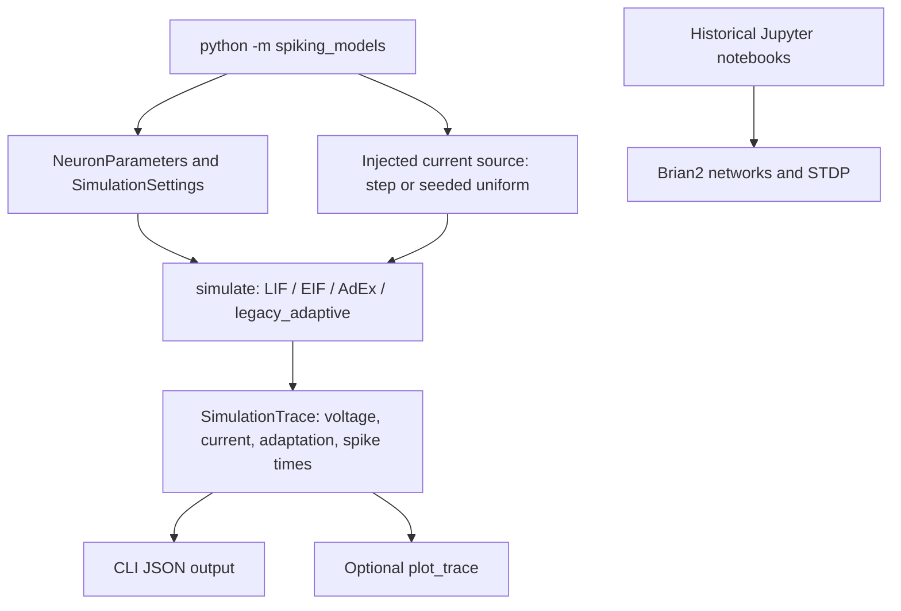

# Architecture and execution

The new package is deliberately small: a pure-Python simulation core, a command-line composition root, and an optional plotting adapter. The two Brian2 experiment groups remain independent historical notebooks.

Only `simulation.py` performs the numerical update. `__main__.py` performs argument parsing and dependency composition; `plotting.py` has the optional Matplotlib dependency. `tests/` covers numerical edge cases, validation, seeded current generation, model differentiation, and the CLI boundary.

## Design decisions

- **No Docker:** There is no persistent service or deployment target. A Python environment is sufficient.
- **No large dependency injection framework:** The solver takes explicit model settings and a callable stimulus, and random sources receive an injected generator.
- **Historical notebooks are preserved:** Refactoring their scientific algorithms and stored results together would obscure comparisons. The new package is an explicit separate reference implementation.
- **Minimal CI:** Lightweight checks run without Brian2, graphics drivers, external secrets, or expensive simulation workloads.
- **No invented benchmark:** Tests validate implementation invariants, not agreement with unverified historical paper figures.

The diagram was authored directly from the inspected source. Archify was not available in this execution environment.
